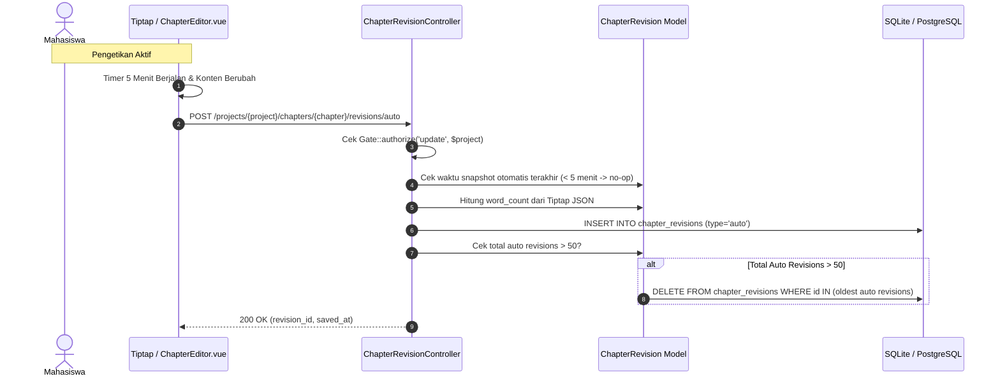
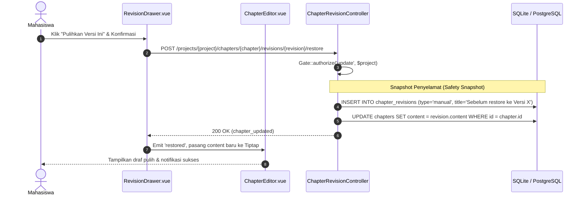
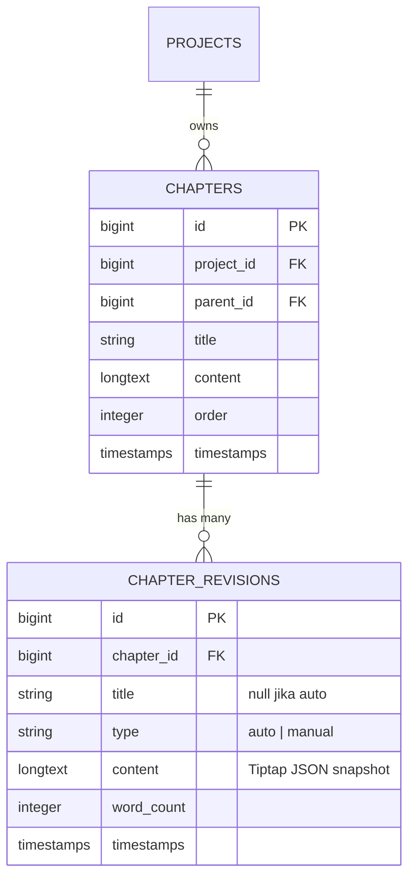

# Technical Design: Chapter Revision Snapshots & Rollback

## 1. Overview
Dokumen desain teknis ini menjabarkan arsitektur data, alur snapshot otomatis, endpoint API, antarmuka drawer Vue 3, serta strategi pengujian untuk fitur Chapter Revision Snapshots & Rollback (Issue #04).

---

## 2. Arsitektur & Diagram Alur

### 2.1 Alur Auto-Snapshot & Manual Checkpoint


### 2.2 Alur Pemulihan (Rollback)


---

## 3. Data Model & Skema Basis Data

### 3.1 Entity Relationship Diagram (ERD)


### 3.2 Migrasi Basis Data (`database/migrations/..._create_chapter_revisions_table.php`)
```php
Schema::create('chapter_revisions', function (Blueprint $table) {
    $table->id();
    $table->foreignId('chapter_id')->constrained()->cascadeOnDelete();
    $table->string('title')->nullable(); // Label checkpoint manual
    $table->string('type')->default('auto'); // 'auto' atau 'manual'
    $table->longText('content'); // Snapshot Tiptap JSON
    $table->unsignedInteger('word_count')->default(0);
    $table->timestamps();

    $table->index(['chapter_id', 'type', 'created_at']);
});
```

---

## 4. API Design & Endpoints

| Method | Endpoint | Fungsi | Payload / Respon |
| :--- | :--- | :--- | :--- |
| `GET` | `/projects/{project}/chapters/{chapter}/revisions` | Ambil daftar riwayat revisi | JSON array entri revisi (tanpa payload content besar untuk optimasi kecepatan daftar) |
| `POST` | `/projects/{project}/chapters/{chapter}/revisions/auto` | Simpan snapshot otomatis berkala | Body: `{ content: [...] }`. Cek interval 5 menit & pangkas batas 50 |
| `POST` | `/projects/{project}/chapters/{chapter}/revisions/checkpoint` | Simpan manual checkpoint | Body: `{ title: "Draft Bab 1 Siap Bimbingan" }` |
| `GET` | `/projects/{project}/chapters/{chapter}/revisions/{revision}` | Ambil detail satu revisi untuk preview | JSON objek revisi lengkap dengan content |
| `POST` | `/projects/{project}/chapters/{chapter}/revisions/{revision}/restore` | Pulihkan chapter ke versi ini | Menghasilkan safety snapshot lalu menimpa konten chapter |

---

## 5. Komponen Frontend (Vue 3 / Inertia)

1. **`resources/js/Components/RevisionDrawer.vue`**:
   - Panel samping (*slide-over drawer*) yang memuat daftar revisi secara asinkron.
   - Kartu revisi interaktif dengan badge `Otomatis` / `Manual`, stempel waktu relatif, dan jumlah kata.
   - Panel pratinjau (*preview panel*) konten revisi dalam format *read-only*.
   - Tombol "Pulihkan Versi Ini" dengan modal konfirmasi peringatan.
2. **Integrasi ke `ChapterEditor.vue`**:
   - Penambahan tombol "Riwayat Versi" dan "Simpan Checkpoint" pada *toolbar*.
   - Timer interval auto-snapshot 5 menit yang mendeteksi status ketikan aktif (*dirty state*).
   - Penanganan event `restored` untuk memuat ulang doc Tiptap secara instan.

---

## 6. Security & Guardrails
- **Otorisasi**: Semua rute controller wajib dicek menggunakan `Gate::authorize('update', $project)` dan verifikasi `abort_if($chapter->project_id !== $project->id, 404)`.
- **Tenant Scoping**: Rute revisi menggunakan *scoped bindings* untuk memastikan `chapter_id` dan `revision_id` valid milik `project_id`.
- **Cascading Deletion**: Foreign key constraint `cascadeOnDelete()` memastikan saat bab atau proyek dihapus, seluruh riwayat revisi musnah seketika tanpa meninggalkan data yatim (*orphan data*).

---

## 7. Performance & Storage Protection
- **FIFO Pruning**: Saat `type = 'auto'` mencapai > 50 per chapter, query pembersihan menghapus baris tertua:
  ```php
  $autoRevisions = $chapter->revisions()->where('type', 'auto')->orderBy('created_at', 'desc')->get();
  if ($autoRevisions->count() > 50) {
      $idsToDelete = $autoRevisions->slice(50)->pluck('id');
      ChapterRevision::whereIn('id', $idsToDelete)->delete();
  }
  ```
- **Optimasi List**: Endpoint index revisi mengecualikan kolom `content` untuk menjaga ukuran payload JSON tetap kecil (< 5KB).

---

## 8. Testing Strategy (Pest Tests)
File uji: `tests/Feature/ChapterRevisionTest.php`
1. `test_can_list_chapter_revisions_for_authorized_user`
2. `test_unauthorized_user_cannot_access_chapter_revisions`
3. `test_creates_auto_snapshot_when_interval_elapsed`
4. `test_does_not_create_duplicate_auto_snapshot_within_5_minutes`
5. `test_caps_auto_snapshots_at_50_with_fifo_rotation`
6. `test_manual_checkpoints_are_exempt_from_50_cap_rotation`
7. `test_can_restore_chapter_to_previous_revision_with_safety_snapshot`
8. `test_cascade_deletes_revisions_when_chapter_or_project_deleted`

---

## 9. Design Checklist
- [x] Arsitektur didokumentasikan dengan diagram Mermaid.
- [x] Skema database dan relasi Eloquent terdefinisi jelas.
- [x] Kontrak API dan otorisasi aman (anti-leakage).
- [x] Strategi pengujian komprehensif disiapkan.
